<a href="https://www.skylarkgo.in">
  <picture>
    <source media="(prefers-reduced-motion: reduce)" srcset=".github/assets/banners/hero-static.webp" />
    
  </picture>
</a>

<p align="center">
  <b>Skylark is a human-assisted job application service for people applying across borders.</b><br />
  It ranks the roles you can actually take, explains every score, tailors each application with your approval,<br />
  and has a specialist review and submit it, with a receipt for every one.
</p>

<p align="center">
  <a href="https://www.skylarkgo.in"></a>
  
  
  
  <a href="LICENSE"></a>
</p>

<p align="center">
  <a href="#capstone-review">Capstone review</a> ·
  <a href="#what-is-skylark">Overview</a> ·
  <a href="#product-tour">Tour</a> ·
  <a href="#core-capabilities">Capabilities</a> ·
  <a href="#how-it-works">How it works</a> ·
  <a href="#the-match-engine">Match engine</a> ·
  <a href="#architecture">Architecture</a> ·
  <a href="#quick-start">Quick start</a> ·
  <a href="#security-and-privacy">Security</a> ·
  <a href="#roadmap">Roadmap</a>
</p>


## Capstone review

Skylark is Team Synapse X's Semester 3 capstone (B.Tech CSE, SRM University Andhra Pradesh). Everything the review
asks for is in this repository:

| | |
|---|---|
| **Code** | [`src/`](src), with tests in [`e2e/`](e2e) and [`supabase/tests`](supabase/tests). Live at [skylarkgo.in](https://www.skylarkgo.in). |
| **Problem statement** | [`docs/problem-statement`](docs/problem-statement): who has the problem, when, and what it costs them |
| **Interview notes** | [`docs/interview-notes`](docs/interview-notes): everyone we spoke to, with dates and roles |
| **Slides** | [`docs/slides`](docs/slides): the HTML deck with speaker notes, and a PDF copy |
| **What we have not built** | [`docs/not-built.md`](docs/not-built.md): the gaps, with our reasons |


## What is Skylark?

Most job boards optimise for volume. For someone looking for work in another country, volume is the
problem: most of the listings they see are roles they cannot legally take, at companies that will never
sponsor them, and mass-applying burns their name with recruiters.

Skylark is built the other way round. A candidate builds one validated profile. Skylark imports live
listings, scores every role against that profile on seven published factors (work authorization and
sponsorship among them), and writes down why. AI drafts a tailored resume and cover letter, the candidate
accepts or rejects each change, and a human specialist reviews the application against a checklist
before submitting it and recording the proof.

Most job boards are built to maximise volume. But for candidates seeking international career opportunities, volume is often the problem. They spend countless hours navigating roles they are not legally eligible for, companies that do not offer visa sponsorship, and repetitive applications that risk damaging their credibility with recruiters.

Skylark is built on a fundamentally different approach — precision over volume.

Candidates create a single, validated professional profile. Skylark continuously imports live job listings, evaluates each opportunity against seven transparent scoring factors, including work authorisation and visa sponsorship, and provides clear reasoning behind every match.

AI then generates a tailored resume and cover letter, while candidates retain complete control over every proposed change. Before submission, a human specialist reviews each application against a structured quality checklist, ensures its accuracy, and records verifiable proof of submission.

The result is a smarter, more transparent and accountable job application experience that combines AI-powered intelligence with human expertise — helping candidates pursue the right opportunities, rather than simply more of them.

| | A typical job board | Skylark |
|---|---|---|
| **Eligibility** | Your problem | A factor in every score; a role you cannot take is capped at 35 |
| **Match score** | One opaque percentage | Seven weighted factors, each with a written reason |
| **Applications** | The same resume everywhere | Tailored per role, and nothing changes until you accept it |
| **Quality control** | None | A specialist checks five points within a 24-hour SLA |
| **Employer forms** | Retyped for every portal | Answered once in the answer vault |
| **Proof** | Take our word for it | Portal and confirmation reference on every submission |


## Product tour

<p align="center">
  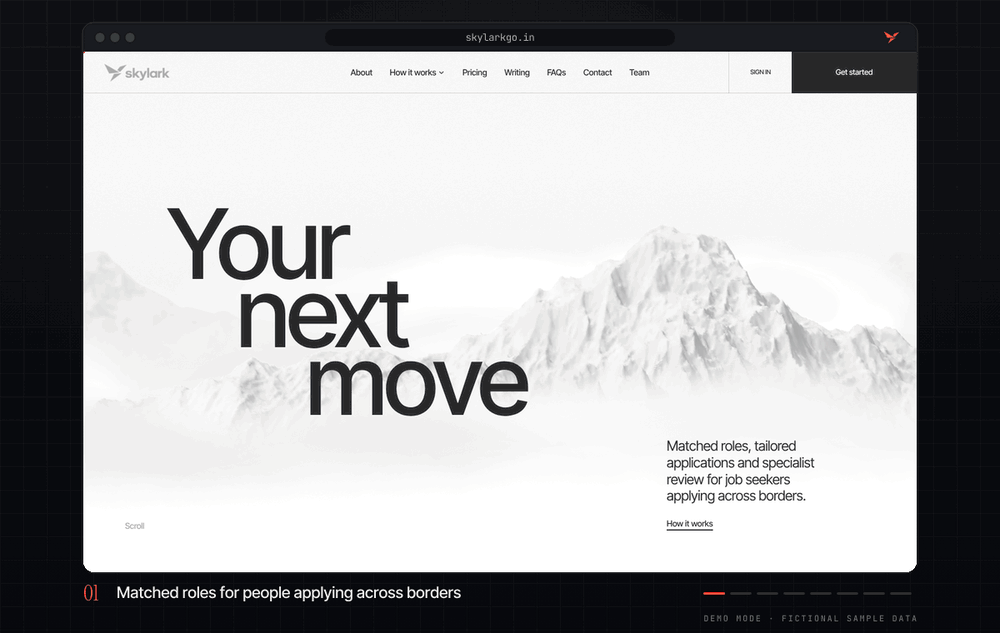
  <br />
  <sub>Captured from the running app in demo mode. Companies, jobs and people are fictional sample data.</sub>
</p>


## Core capabilities

<table>
  <tr>
    <td width="50%" valign="top">
      
      <p><b>Explainable matching.</b> Skills, experience, education, eligibility, location, sponsorship and
      preferences, each scored 0 to 100 with a sentence you can read. The weights are public constants in
      <code>engine.ts</code>, and the score is their weighted sum.</p>
    </td>
    <td width="50%" valign="top">
      
      <p><b>Eligibility first.</b> Where you can already work, whether you need sponsorship, and where you would
      relocate are first-class profile fields. A listing that will not sponsor a candidate who needs it is
      capped at 35, whatever the skills say.</p>
    </td>
  </tr>
  <tr>
    <td width="50%" valign="top">
      
      <p><b>Tailoring you approve.</b> A role-specific summary, rewritten bullets, a cover letter and a skill-gap
      table, each with the reason for the change. Nothing is applied until you accept it, and the prompt
      forbids invented employers, titles or numbers.</p>
    </td>
    <td width="50%" valign="top">
      
      <p><b>Human review.</b> Approved applications enter a queue with a 24-hour SLA. A specialist confirms work
      authorization, accuracy, the cover letter, hard requirements and portal details, then approves or sends
      it back with a note.</p>
    </td>
  </tr>
  <tr>
    <td width="50%" valign="top">
      
      <p><b>Answer the forms once.</b> The two dozen questions every portal asks live in one vault. An unanswered
      question stays unanswered rather than defaulting to "No", and EEO self-identification is unreadable from
      any browser session, the owner's included.</p>
    </td>
    <td width="50%" valign="top">
      
      <p><b>Managed delivery with receipts.</b> Plans carry a daily application quota (10, 25 or 40 a working day).
      Recording a submission, with its portal and the employer's confirmation reference, is the only thing that
      moves the counter.</p>
    </td>
  </tr>
</table>

Also in the box: chat-style onboarding (Gemini proposes, the same validators as the form decide), a support
inbox shared between candidates and staff, partner referral links and server-priced promo codes, Razorpay
subscriptions in INR with signed webhooks, email verification codes over SMTP, a privacy export and account
deletion, and four long-form articles authored as typed content blocks.


## How it works


1. **Build a profile.** Upload a resume and the headline, skills and experience are extracted. Every field is
   validated on the server: names in any script, gibberish detection, skills checked against a curated
   taxonomy, Stack Overflow tags and ESCO, locations against ISO 3166 and GeoNames, email domains by DNS.
2. **Verification.** New and edited profiles go to a review queue with automatic flags (a GitHub name mismatch,
   skill years beyond total experience, and so on). Applications can be sent for review only once the profile
   is approved.
3. **Match.** Live listings are scored against the profile; matches of 85 or more trigger a notification.
4. **Tailor and approve.** Claude drafts the materials (or the deterministic rules provider, when no key is set
   or the call fails); you accept or reject each suggestion and approve the version.
5. **Review and submit.** A specialist claims the application, works the checklist, submits it, and records the
   portal and confirmation reference. A short day is reported as a short day, with its reason.
6. **Track.** Saved, preparing, human review, applied, then screening, interview and offer, on a board with
   notes, next steps and a full activity history.


## The match engine


| Factor | Weight | What it looks at |
|---|---:|---|
| Skills | 30% | Required skills matched, weighted by proficiency; half credit for a close sibling (Vue for React, GCP for AWS) |
| Eligibility | 20% | Authorized today, eligible with sponsorship, or blocked |
| Experience | 18% | Years against the minimum, and seniority against the role's level |
| Location | 12% | Home country and city, target countries, relocation, remote preference |
| Sponsorship | 8% | What the listing says, then the employer's sponsorship history |
| Preferences | 7% | Preferred roles and salary floor |
| Education | 5% | The degree the listing asks for against your highest completed one |

The engine is a pure function (`scoreMatch(profile, job, company)`) with a versioned model id
(`match-v2.0`), so it runs identically in the worker, in the UI and in tests. Two rules keep it honest:
an ineligible role is capped at 35 so it can never outrank one you can take, and skills seen only in a
candidate's public GitHub repositories are shown as supporting evidence but never add to the score.


## Architecture


**One repository interface, two stores.** Every service talks to `Repository` (`src/lib/data`). With Supabase
variables set, it is backed by Postgres with row level security; without them, by an in-memory seeded store.
That is why the whole product runs locally with zero setup, and why services never know which store they use.

**Two trust levels for data access.** Reads and writes made for a person go through their session, so RLS
applies. System-authored rows (matches, queue jobs, audit entries, AI events) are written with the service
role, server-side only, and the tables give browser sessions no write path to them.

**`proxy.ts` is an optimistic gate, not the lock.** It refreshes the session and routes people early, but
authorization is re-checked in a data access layer on every page, action and route handler.

**AI behind an interface.** Product code calls `AIProvider`, never a model SDK. Claude output is validated
against a Zod schema; if the call fails or no key is configured, the deterministic rules provider produces
the result instead, so a provider outage never blocks a candidate.

### The job pipeline


| Concern | How it is handled |
|---|---|
| Sources | One `JobSource` interface: Arbeitnow (keyless, on by default), 16 public Greenhouse boards by default, plus Adzuna, The Muse and Lever when configured |
| Duplicates | A sha256 fingerprint of company, normalised title and country collapses cross-posts; `(source, external_id)` catches a board renaming a role |
| Freshness | Listings a source stops showing (on a complete fetch) or older than `JOB_MAX_AGE_DAYS` (default 45) are closed. If no source refreshed in 24 hours, candidates see a "live job data is unavailable" notice |
| Retries | Fetches retry three times with backoff; queue jobs back off exponentially with jitter, then dead-letter |
| Concurrency | Workers claim with `FOR UPDATE SKIP LOCKED`, so many can drain the queue without double-processing |
| Idempotency | Every enqueue carries a key (ingestion is keyed per source per hour), so a retried cron cannot double-schedule |
| Trigger | Vercel Cron calls `/api/cron/worker` with a bearer secret, daily at 09:00 UTC on the Hobby plan |

<details>
<summary><b>Application lifecycle and data model</b></summary>
<br />

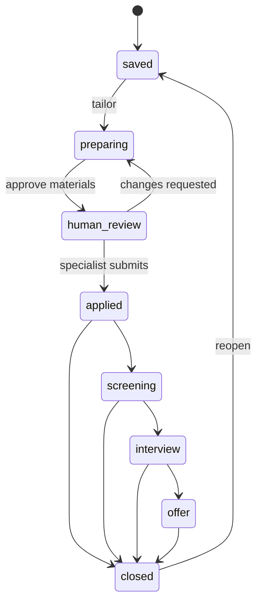

Candidates can move cards only along allowed transitions. Entering human review requires an approved
tailored document, and moving from human review to applied is something only a specialist can do.

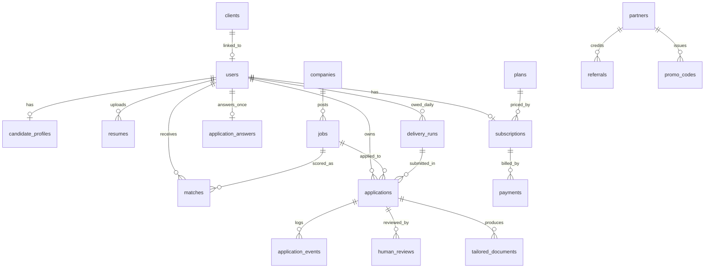

Plus `profile_verifications`, `skill_requests`, `notifications`, `audit_logs`, `leads`, `background_jobs`,
`ingestion_runs`, `idempotency_keys` and `rate_limits`. The schema lives in
[`supabase/migrations`](supabase/migrations).

</details>


## Engineering highlights

- **Security claims are tested against real Postgres.** The suite applies every migration to an in-process
  Postgres ([PGlite](https://pglite.dev)) and proves the policies: candidates cannot read each other's rows,
  promote themselves, forge AI-authored events or write outside their storage folder, and the queue hands each
  job to exactly one worker. Those tests caught a column `REVOKE` that did nothing while a table-wide grant
  existed, and a `REVOKE EXECUTE` that left the default `PUBLIC` grant in place.
- **Fail closed, never invent.** If every skill vocabulary is down, verification says so instead of passing.
  If exchange rates cannot be fetched, prices stay in the billing currency rather than showing a stale rate.
  If job data is stale, candidates are told.
- **Sample data is labelled.** Fictional listings carry `source: "sample"` and a visible label, and are never
  written to a real database unless you run the demo seed.
- **Content without an injection surface.** Blog posts are typed content blocks in the repository, rendered
  without `dangerouslySetInnerHTML`, with metadata and `BlogPosting` structured data built from the same source.
- **Uploads checked by content.** Resumes are validated by magic bytes, stored under `<user-id>/` in a private
  bucket and served through short-lived signed URLs.
- **Money is exact about what it is.** Plans are charged in INR through Razorpay subscriptions; any converted
  price is marked `≈`, rounded to whole units, and shown next to the amount that will actually be billed.


## Screens

<table>
  <tr>
    <td width="50%">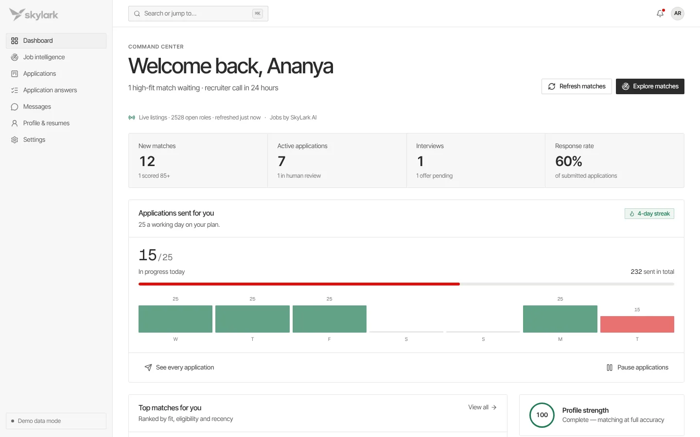<br /><sub><b>Dashboard.</b> Matches, applications and today's delivery progress.</sub></td>
    <td width="50%">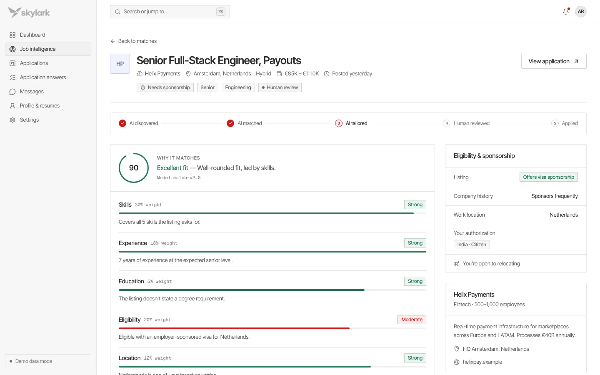<br /><sub><b>Why a role matches.</b> Every factor with its weight, rating and reason.</sub></td>
  </tr>
  <tr>
    <td width="50%">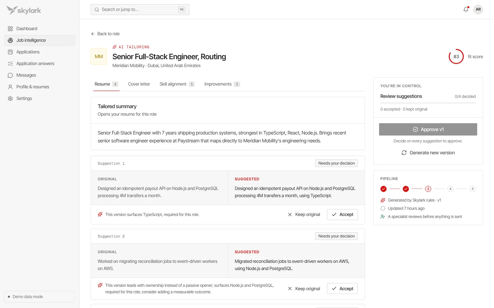<br /><sub><b>Tailoring.</b> Original against suggested, with the reason for each change.</sub></td>
    <td width="50%">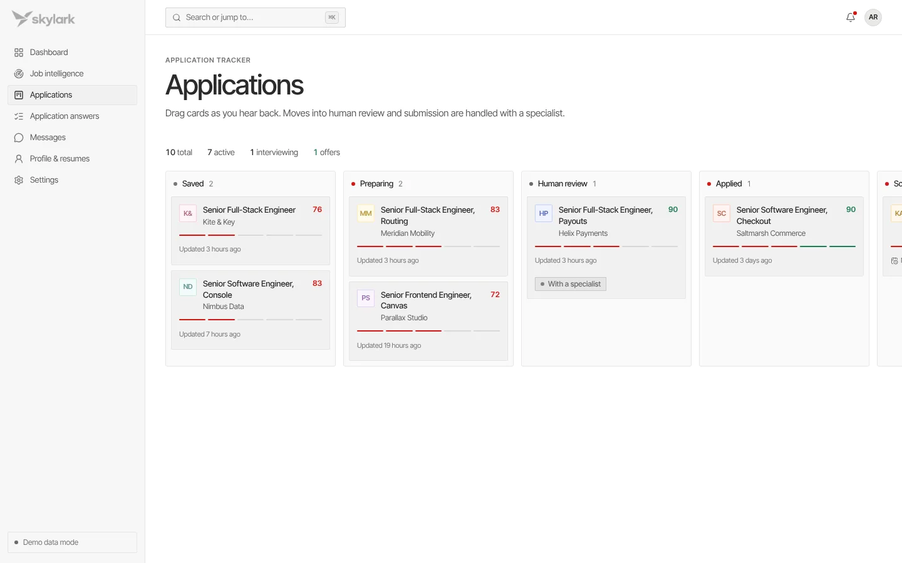<br /><sub><b>Tracker.</b> Drag between allowed stages, or use the Move menu.</sub></td>
  </tr>
  <tr>
    <td width="50%">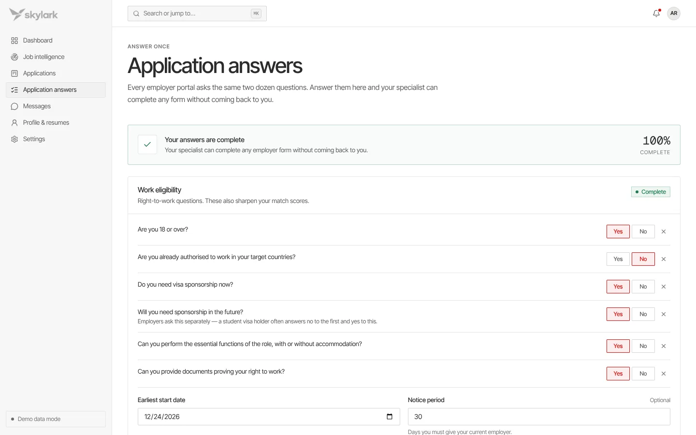<br /><sub><b>Answer vault.</b> Employer form questions, answered once.</sub></td>
    <td width="50%">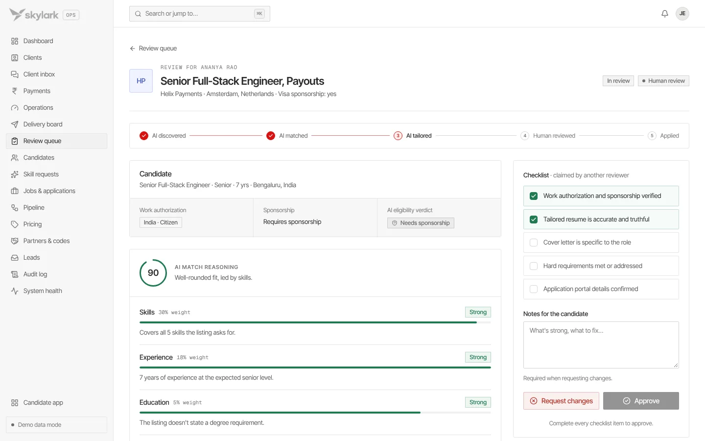<br /><sub><b>Specialist review.</b> Eligibility, AI reasoning and the checklist side by side.</sub></td>
  </tr>
  <tr>
    <td width="50%">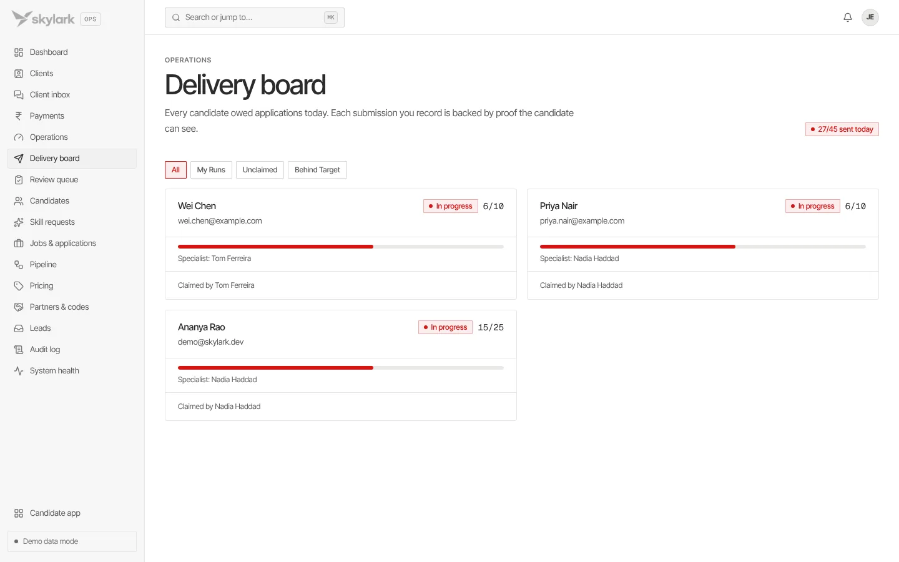<br /><sub><b>Delivery board.</b> Each candidate's daily target and what has been submitted.</sub></td>
    <td width="50%">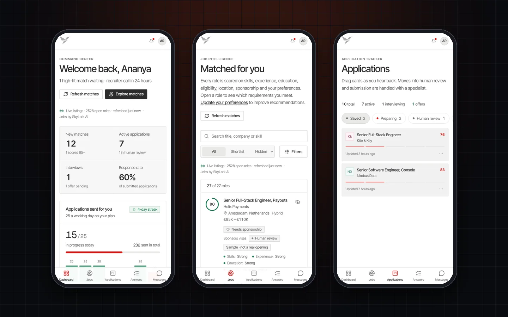<br /><sub><b>On a phone.</b> Bottom tab bar, one tracker column at a time.</sub></td>
  </tr>
</table>


## Technology

| Layer | Choice | Why it is here |
|---|---|---|
| Framework | Next.js 16 App Router, React 19, Turbopack, Cache Components | Server Components stream data-heavy pages; Server Actions keep mutations typed and server-side |
| UI | Tailwind CSS v4, Radix primitives, Framer Motion; GSAP, Lenis and WebGL on the marketing site | Accessible primitives for the app, cinematic motion where it is a brand moment |
| Validation | Zod 4 | One schema validates on the server and drives inline feedback in the browser |
| Data | Supabase: Postgres with RLS, Auth (email, Google), Storage | Authorization enforced by the database, not only by application code |
| AI | Claude via `@anthropic-ai/sdk` (tailoring, resume extraction); Gemini for chat onboarding | Both optional; deterministic fallbacks keep every flow working without keys |
| Payments | Razorpay subscriptions, signature-verified webhooks | Charges in INR from an Indian account |
| Email | Nodemailer over SMTP | Verification codes before a plan can be bought |
| Hosting | Vercel (Sydney region, next to the Supabase project), Vercel Cron | Functions and database in the same region |
| Tests | Vitest, PGlite, Playwright | Unit, database-policy and end-to-end coverage |

## Repository structure

```text
src/
├─ app/
│  ├─ (marketing)/        Landing page, how it works, pricing, writing, team, terms, privacy
│  ├─ (auth)/             Sign in, sign up
│  ├─ (app)/              Dashboard, jobs, tailoring, applications, answers, messages, profile, partner
│  ├─ onboarding/         Form and chat-style onboarding
│  ├─ actions/            Server Actions: typed results, rate limited, audited
│  └─ api/                REST v1, cron worker, Razorpay webhook, exports, health
├─ components/            Design system primitives, product and marketing components
└─ lib/
   ├─ data/               Repository interface: Supabase and in-memory implementations
   ├─ services/           Matching, tailoring, applications, reviews, delivery, billing, verification…
   ├─ pipeline/           Job sources, normalisation, ingestion, queue, worker
   ├─ ai/                 Provider interface: Claude, Gemini, rules fallback
   ├─ skills/ validation/ Taxonomy, ESCO, Stack Overflow snapshot; name, link and email checks
   └─ infra/ auth/        Rate limiting, retries, structured logging, sessions
supabase/
├─ migrations/            Schema, RLS, column grants, plans, managed service, clients
└─ tests/                 Policy tests against the real migrations
e2e/                      Playwright journeys, including phone layouts
docs/                     Capstone material: problem statement, interview notes, slides, not built
.github/
├─ assets/                Everything this README shows
└─ assets-src/            The code that generates it
```


## Quick start

No accounts, keys or database needed: without Supabase variables the app runs in demo mode on seeded,
clearly labelled sample data.

```bash
git clone https://github.com/rohanmalyadri/SkyLark.git
cd SkyLark
npm install
npm run dev
```

Open <http://localhost:3000>, choose **Sign in**, and pick **Candidate** or **Operations** under
*Explore with demo data*. Demo data lives in memory and resets when the server restarts.

## Running against Supabase

1. Create a Supabase project and enable the Email provider (and Google, if you want it).
2. Apply [`supabase/migrations`](supabase/migrations) in order, with `supabase db push` or the SQL editor.
3. Copy the environment template and fill it in:
   ```bash
   cp .env.example .env.local
   ```
4. Optionally load the demo dataset into a staging project (it contains fictional listings):
   ```bash
   npm run seed -- --demo
   ```
5. Deploy. [`vercel.json`](vercel.json) pins functions to `syd1` and schedules the worker daily.

A step-by-step guide, including Google sign-in and Razorpay, is in [`docs/backend-setup.md`](docs/backend-setup.md).

### Environment variables

Every variable is optional in demo mode. The full annotated list is in [`.env.example`](.env.example).

| Variable | Purpose |
|---|---|
| `NEXT_PUBLIC_APP_URL` | Public URL; sign-in and email links return here |
| `NEXT_PUBLIC_SUPABASE_URL`, `NEXT_PUBLIC_SUPABASE_ANON_KEY`, `SUPABASE_SERVICE_ROLE_KEY` | All three switch on production mode. The service role key is server-only |
| `SESSION_SECRET` | Signs demo-mode sessions; required in production without Supabase |
| `SUPABASE_GOOGLE_AUTH`, `GOOGLE_CLIENT_ID`, `GOOGLE_CLIENT_SECRET` | Google sign-in, through Supabase or directly |
| `ANTHROPIC_API_KEY`, `AI_MODEL` | Claude for tailoring and resume extraction; the rules provider is used without a key |
| `GEMINI_API_KEY`, `GEMINI_MODEL` | Chat-style onboarding; without a key onboarding is form-only |
| `RAZORPAY_KEY_ID`, `RAZORPAY_KEY_SECRET`, `RAZORPAY_WEBHOOK_SECRET` | Subscriptions and webhook verification |
| `SMTP_USER`, `SMTP_PASSWORD` (+ `SMTP_HOST`, `SMTP_PORT`, `EMAIL_FROM`) | Email verification codes; once set, buying a plan needs a verified email |
| `CRON_SECRET` | Bearer token for `/api/cron/worker` |
| `ADMIN_EMAILS` | Comma-separated emails promoted to admin on sign-in, to bootstrap a project |
| `JOB_SOURCES`, `JOB_MAX_AGE_DAYS` | Source allow-list and listing expiry (default 45 days) |
| `GREENHOUSE_BOARDS`, `LEVER_COMPANIES`, `ADZUNA_*`, `MUSE_API_KEY` | Additional job sources |
| `STACKEXCHANGE_KEY`, `LIGHTCAST_CLIENT_ID`/`_SECRET`, `GITHUB_TOKEN`, `EMAIL_DOMAIN_CHECK` | Higher quotas and extra vocabularies for verification |

## API

| Endpoint | Description |
|---|---|
| `GET /api/v1/matches` | The signed-in candidate's ranked matches with per-factor explanations; accepts the UI's filters |
| `GET /api/v1/applications` | The candidate's tracker |
| `POST /api/v1/applications` | Save a job. Requires an `Idempotency-Key` header; a replay returns the original response |
| `GET /api/resumes/:id` | Owner download through a signed URL; staff access for verification is audit-logged |
| `GET /api/skills/suggest?q=` | Skill suggestions with spelling hints and degraded-source reporting (rate limited) |
| `GET /api/roles/suggest?q=` | ESCO occupation suggestions (rate limited) |
| `GET /api/geo/countries`, `…/:code/regions`, `…/:code/cities` | Location data for profile fields |
| `GET /api/me/export` | Everything held about the signed-in person, as JSON |
| `POST /api/webhooks/razorpay` | Subscription events, signature-verified |
| `GET /api/cron/worker` | Bearer-protected: enqueues ingestion, opens the day's delivery runs, drains due jobs |
| `GET /api/health` | Liveness probe |

```bash
curl -s https://www.skylarkgo.in/api/health

# Saving a job is idempotent: send the same key twice and it is saved once.
curl -s -X POST http://localhost:3000/api/v1/applications \
  -H "Content-Type: application/json" -H "Idempotency-Key: $(uuidgen)" \
  -b "<your session cookie>" -d '{"jobId":"<job id>"}'
```

## Testing

```bash
npm test            # unit tests and the PGlite database-policy suite (264 tests in 24 files)
npm run test:e2e    # Playwright end-to-end, including phone-width layouts
npm run typecheck
npm run lint
```

Coverage spans validation (gibberish, names in any script, links, email DNS), skills and spelling,
ingestion and normalisation, the matching engine, tailoring, the answer vault, managed delivery quotas,
billing and promo codes, currency conversion, sessions, support chat, privacy export and erasure, and the
database policies described below.


## Security and privacy

| Layer | What protects it |
|---|---|
| Row level security | On every table. Candidates see only their own rows; staff read operational data |
| Column privileges | A signed-in user cannot change their own `role` or `email`, only an allow-listed set of columns |
| System-authored rows | Matches, AI events, audit logs, queue jobs, verifications and delivery runs have no browser write path |
| EEO self-identification | `SELECT` on the column is revoked from every browser role; a specialist must name the form that needs it, and each unlock is audited |
| Promo codes | Not readable from the browser. Codes are quoted server-side (rate limited per IP) and redeemed only on a successful payment, with the cap enforced inside Postgres |
| Storage | Private bucket, per-user folders, magic-byte checks, short-lived signed URLs |
| Abuse | Postgres-backed rate limits, safe-redirect validation, idempotency keys on mutating API calls |
| Observability | Structured JSON logs with secret redaction and an append-only audit trail |
| Privacy | Candidates can export everything held about them or delete their account from Settings |
| External evidence | GitHub data is shown to reviewers as evidence, never as a verified credential; LinkedIn links are self-reported |

<details>
<summary><b>Data sources</b></summary>
<br />

Every external source is a documented public API; nothing is scraped.

| What | Source |
|---|---|
| Skills | Curated taxonomy with synonyms, Stack Exchange tags API, ESCO, optional Lightcast Open Skills; spelling help from a bundled Stack Overflow tag snapshot (CC BY-SA 4.0) |
| Roles | ESCO occupations |
| Locations | `country-state-city` (ISO 3166 and GeoNames) |
| Email | Syntax, a disposable-domain list, and a DNS MX/A lookup |
| GitHub | GitHub REST API: account, public languages and repositories |
| Jobs | Arbeitnow, public Greenhouse and Lever boards, Adzuna, The Muse |
| Exchange rates | European Central Bank reference rates via Frankfurter, for display only |

</details>

## Roadmap

Planned next, from the project's open work:

- [ ] Match each candidate against the whole catalogue (today matching reads the newest 5,000 listings), and paginate the job and candidate lists in the operations console
- [ ] SEO groundwork: `robots.txt`, a sitemap, canonical URLs and a share image
- [ ] Performance, a mobile call to action and accessibility fixes from the site review
- [ ] Continuous integration for typecheck, lint and tests on every pull request
- [ ] A password reset flow on top of the new SMTP mailer
- [ ] Re-normalise listings that a source edits, not only new ones
- [ ] More sources for India (Adzuna keys) alongside the global Greenhouse boards

## Contributing

Issues and pull requests are welcome. Before opening one:

```bash
npm run typecheck && npm run lint && npm test
```

Keep secrets in `.env.local` (it is git-ignored), keep fictional data labelled as `sample`, and never treat
external profile data as a verified credential. The README's visuals are generated from code; see
[`.github/assets-src`](.github/assets-src) to change or rebuild them.

## License

Skylark is released under the [MIT License](LICENSE). Copyright © 2026 Rohan Malyadri.

<br />

<a href="https://www.skylarkgo.in">
  
</a>
