<div align="center">


# SkyLark

### Your next move, already in motion.

A human-assisted job application service. Share your profile once: SkyLark ranks the roles you can actually take
(skills, experience, work authorization, sponsorship and location), tailors every application, and a specialist
reviews and submits it, so your time goes to interviews instead of forms.

<br />


[](LICENSE)

[**Quick start**](#quick-start) · [**How it works**](#how-it-works) · [**Architecture**](#architecture) · [**Security**](#security-model) · [**Project structure**](#project-structure) · [**License**](#license)

<br />

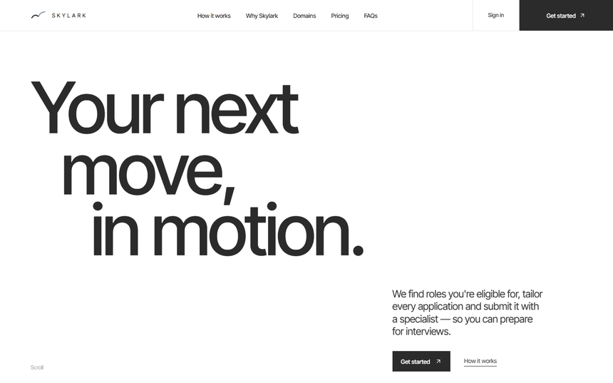

</div>

<br />

## Why SkyLark

Most job boards optimise for volume. If you are looking for a job in another country, volume is the problem: most listings you see are roles you cannot legally take, at companies that will never sponsor you, and mass-applying burns your reputation with recruiters.

SkyLark flips the model.

| | Typical job board | SkyLark |
|---|---|---|
| **Eligibility** | Your problem | A first-class filter on every role |
| **Match score** | A black-box percentage | Six weighted factors, each with a written reason |
| **Applications** | Spray and pray | Tailored per role, approved by you |
| **Quality control** | None | A human specialist reviews before submission |
| **The forms themselves** | Retyped for every employer | Answered once, reused everywhere |
| **Who applies** | You, every evening | A specialist, 10-40 roles every working day |
| **Did it happen?** | Take our word for it | Portal and confirmation reference on every application |
| **Tracking** | A spreadsheet | A board with notes, next steps and full history |

<br />

## How it works

**Profile → Match → Tailor → Apply → Track**


Every application moves through the same visible pipeline, so you always know who did what:

> **AI discovered → AI matched → AI tailored → Human reviewed → Applied**

<br />

### 1. A profile built for crossing borders

Upload a resume and the skills, headline and experience are extracted for you. Then you tell SkyLark what matters: where you can already work, whether you need sponsorship, where you would relocate, and what you need to earn.

<div align="center">
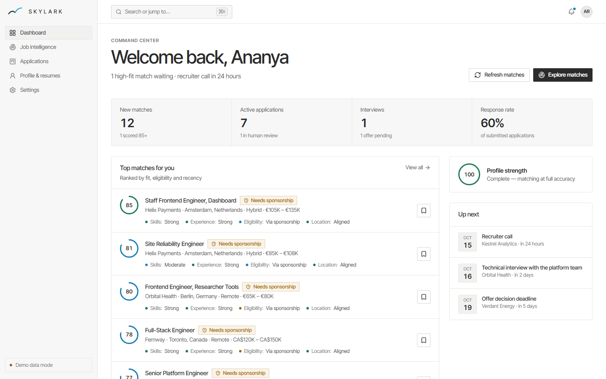
<br /><sub>The command centre: matches, applications, interviews, tasks and recent activity in one place.</sub>
</div>

<br />

### 2. Matches that explain themselves

Every role is scored on six factors. Each one returns a rating **and a sentence you can read**.

| Factor | Weight | What it looks at |
|---|---:|---|
| Skills | 32% | Required skills matched, plus partial credit for related ones (e.g. Vue ↔ React) |
| Experience | 20% | Years and seniority against the role |
| Eligibility | 20% | Can you work there today, or only with sponsorship? |
| Location | 12% | Home country, target countries, relocation, remote eligibility |
| Sponsorship | 8% | Listing language and the employer's sponsorship history |
| Preferences | 8% | Preferred roles and your salary floor |

A role you are legally blocked from is capped at a low score no matter how good the skills are.

<div align="center">
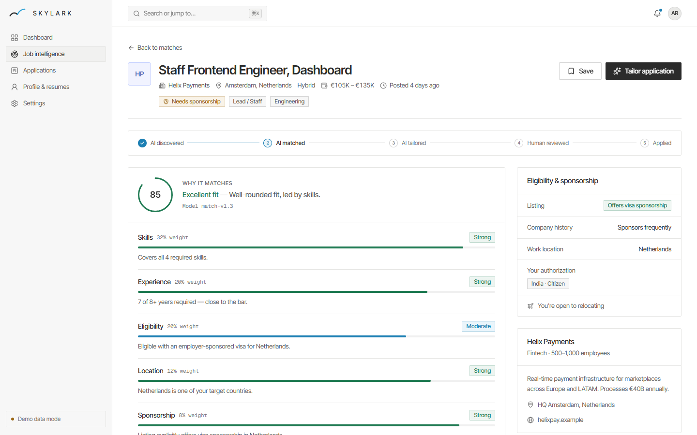
<br /><sub>Why a role matches: each factor shows its weight, rating and reason, with eligibility and sponsorship context alongside.</sub>
</div>

<br />

<div align="center">
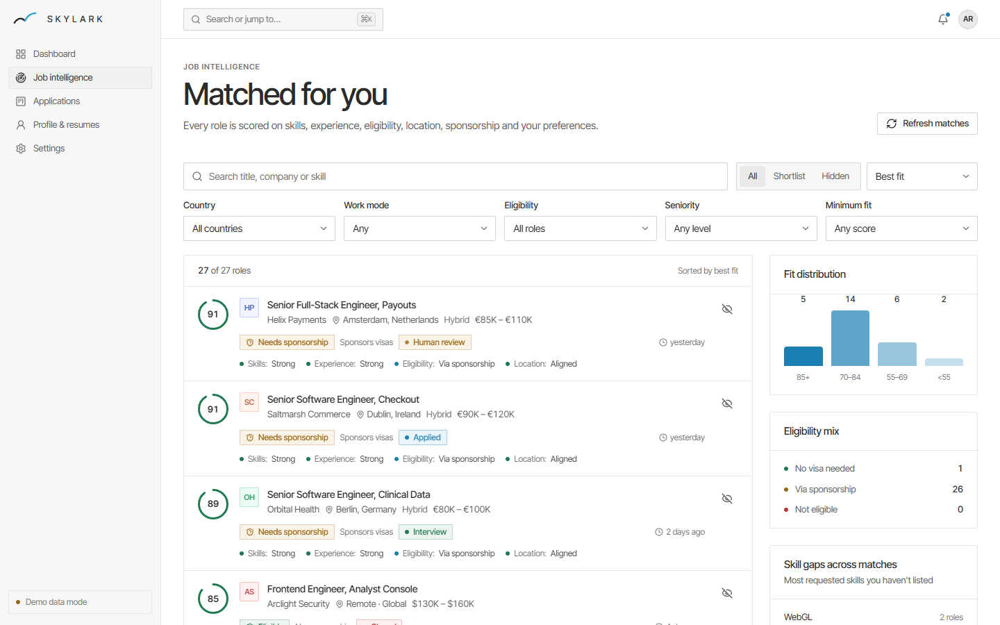
<br /><sub>Job intelligence: filters live in the URL, with fit distribution, eligibility mix and skill gaps across your matches.</sub>
</div>

<br />

### 3. Tailoring where you stay in control

SkyLark drafts a role-specific summary, rewrites resume bullets, writes a cover letter and shows a skill-gap table. **Nothing is applied until you accept or reject each suggestion**, and it never invents employers, titles or numbers.

<div align="center">
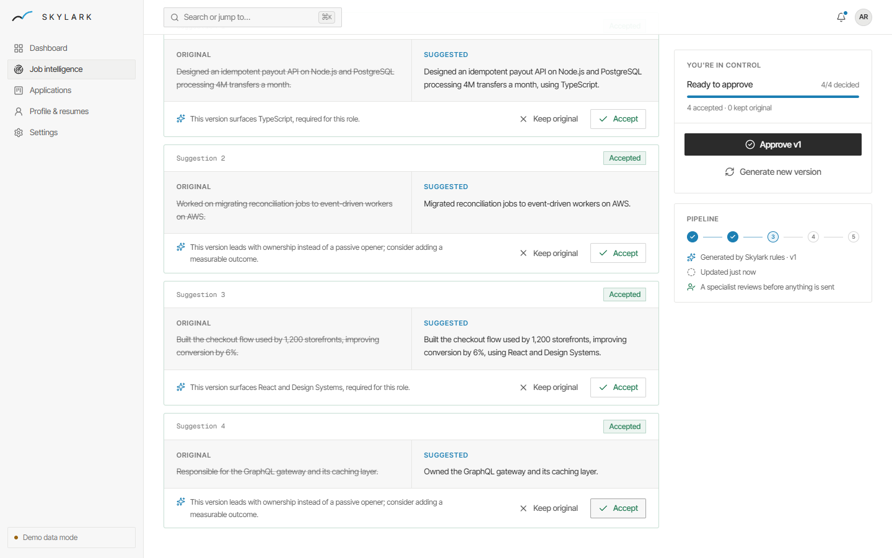
<br /><sub>Original versus suggested, with the reason for every change. Approve the version, then request human review.</sub>
</div>

<br />

### 4. Humans in the loop

Approved applications enter a review queue with a 24-hour SLA. A specialist claims one, works through a checklist (authorization, accuracy, cover letter, requirements, portal details), then approves or requests changes. Only then is it submitted.

<div align="center">
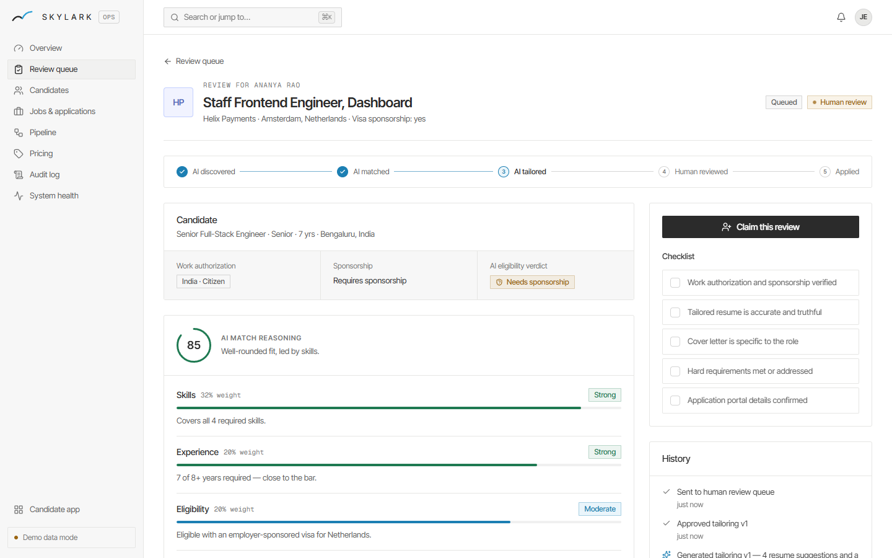
<br /><sub>The specialist's view: candidate eligibility, AI reasoning, tailored materials and the checklist.</sub>
</div>

<br />

### 5. Track everything

<div align="center">
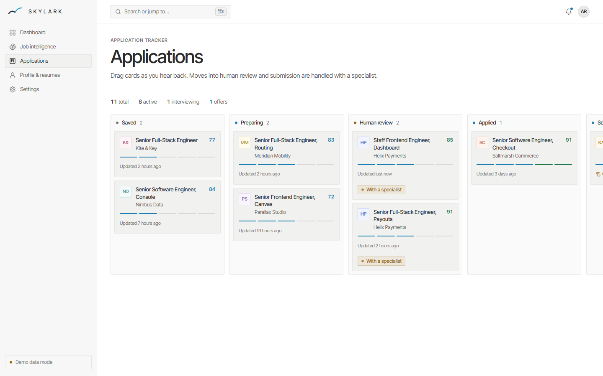
<br /><sub>Saved → Preparing → Human review → Applied → Screening → Interview → Offer → Closed. Drag cards, or use the Move menu.</sub>
</div>

<br />

<div align="center">
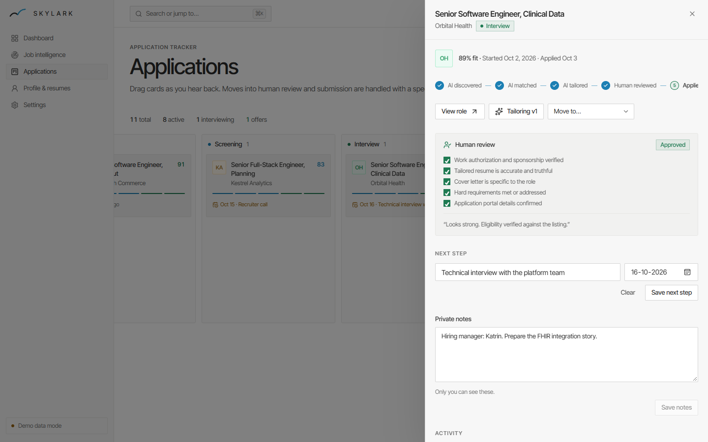
<br /><sub>Per-application drawer: review checklist, next step, private notes and a full activity timeline.</sub>
</div>

<br />

### 6. Answer the forms once

Every employer portal asks the same two dozen questions: are you over 18, do you need
sponsorship now and later, have you worked here before, are you related to an employee, will
you consent to a background check, and the voluntary EEO questions at the end. Answer them
once in the **answer vault** and a specialist can complete any form without coming back to you.

The rule the whole feature is built on: **an unanswered question stays unanswered**. Nothing
defaults to "No", because a wrong answer on an employer form is worse than a blank one. Each
section tracks its own completeness, follow-up questions appear only when the trigger answer
is "yes", and applications cannot be submitted for you until the required questions are done.

Voluntary self-identification is handled differently from everything else in the product:

- it never reaches match scoring, ranking, or any AI prompt;
- the column is **revoked from every browser session in Postgres**, so no session can read it
  — not even the row's owner's;
- the owner sees their own answers because the *server* fetches them after authenticating the
  session, so the data subject can always check what is held about them;
- a specialist can only read it by naming the form that needs it, and every unlock is written
  to the audit log.

### 7. Applications submitted for you, with proof

Each plan carries a **daily application quota** (10, 25 or 40 a working day). A *delivery run*
is one candidate's working day: the target taken from their plan, what was actually submitted,
and the reason when it falls short. Weekends are skipped, and a candidate can pause without
touching their subscription or lower their own target below the plan maximum.

Specialists work from a **delivery board**, and recording a submission is the only thing that
moves the counter — so the number on a dashboard is always backed by a real application row
carrying the portal and the employer's confirmation reference. Candidates see that receipt in
the application drawer. A short day is reported as a short day with its reason, rather than
padded with applications nobody wanted.

### 8. Partners, referrals and promo codes

Partners get a promo code for their audience and a share link (`/r/<token>`) that credits
every sign-up back to them for 30 days. Codes are priced **server-side against real plan
prices**, so a visitor can try one without it being trusted or consumed; redemption happens
only when a payment succeeds, and the cap is enforced inside Postgres so two concurrent
checkouts can never both take the last one. Partners see their own sign-ups, conversions and
earnings; payout terms stay staff-only.

Attribution is parked in a signed, httpOnly cookie rather than `sessionStorage`, so it
survives the real journey — land, read, sign up, confirm email, onboard — and cannot be
forged from the page.

### 9. Prices in your own currency

Plan prices are authored and charged in USD. A visitor can switch the pricing table to any of
twelve currencies and see an indicative figure beside what will actually be billed — pulled
from the ECB's daily reference rates, cached for hours because the ECB publishes once a
working day.

Three rules keep this honest rather than merely convenient:

- a converted figure is always marked `≈` and rounded to whole units, because a daily
  reference rate does not justify showing cents;
- every converted price states the amount that will be charged, in the billing currency;
- if the rates cannot be fetched, the table silently stays in USD. **No stale or invented
  rate is ever attached to a price** — the same fail-closed rule the job catalog follows.

The currency is never auto-detected from the browser locale. Quietly restating a price in a
currency we do not charge in is the kind of helpfulness that becomes a complaint.

### 10. Writing

Four long-form articles on the things candidates actually get wrong: reading sponsorship
signals in a job ad, the questions every application form asks, what a realistic application
volume looks like, and how to read a match score.

Posts are authored **in the repository as typed content blocks**, not Markdown or HTML. Each
block kind maps to real elements, so the blog renders with no `dangerouslySetInnerHTML`
anywhere, has no HTML-injection surface, and carries no Markdown dependency to keep patched.
Every post is prerendered, carries its own metadata and `BlogPosting` structured data built
from the same source as the page, and the content itself is covered by integrity tests.

### Designed for phones too

The mobile experience is designed on its own terms: a bottom tab bar, one status column at a time on the tracker, and bottom-sheet filters.

<div align="center">
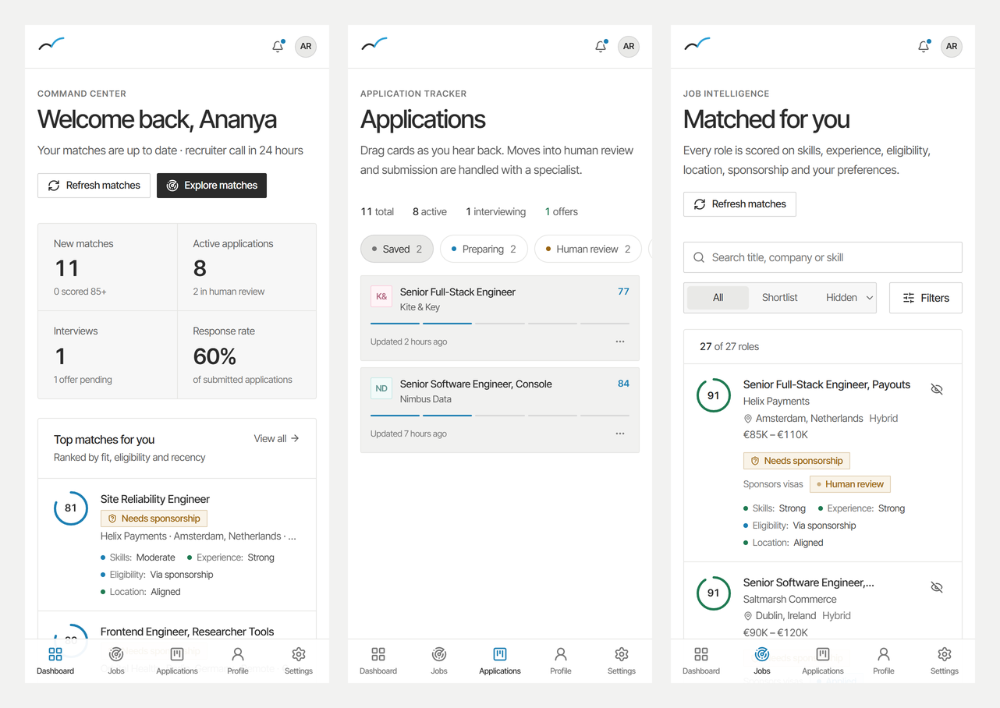
</div>

<br />

## The operations console

Staff get their own console: the delivery board, review queue, candidates, jobs and
applications, the ingestion pipeline, partners and promo codes, the lead inbox, an audit log,
system health, and **pricing that is stored in the database**, so plans can be edited without
a deploy.

There are three staff roles. **Reviewers** approve tailored applications. **Application
specialists** (operators) submit them and are the only role that can record a submission or
unlock a candidate's self-identification. **Administrators** do both, plus partners, pricing
and accounts.

<div align="center">
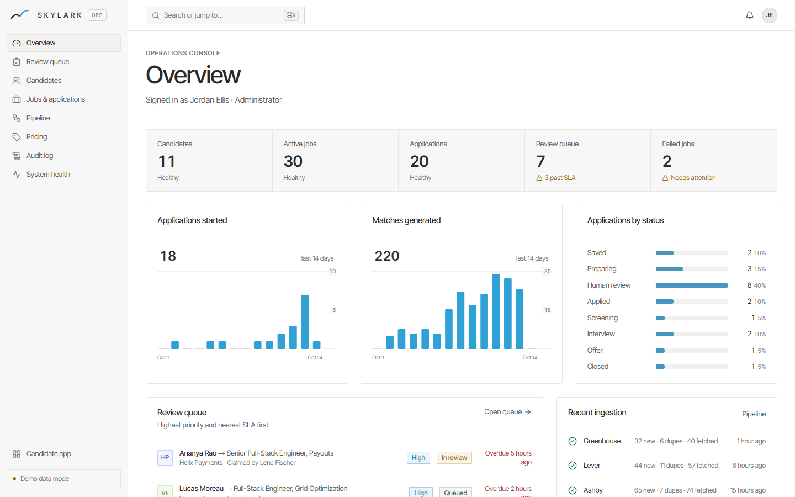
<br /><sub>Live KPIs, 14-day activity, status distribution, SLA alerts and failed jobs.</sub>
</div>

<br />

<div align="center">
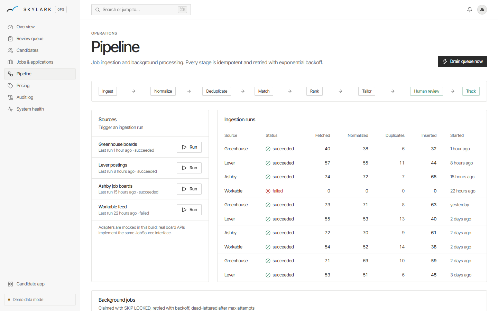
<br /><sub>Trigger ingestion, watch runs, and retry or inspect background jobs.</sub>
</div>

<br />

## Architecture

### System overview

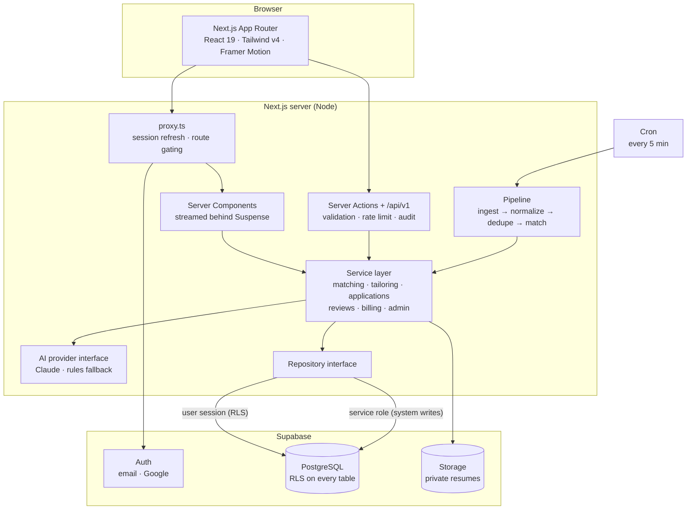

The data layer sits behind a single `Repository` interface with two implementations: **Supabase** (production) and an **in-memory seeded store** (demo mode). Services never know which one they are talking to, which is why the whole product runs with zero setup.

### The job pipeline

Everything between a posting appearing on a job board and a ranked match on a candidate's screen is asynchronous, idempotent and retried.

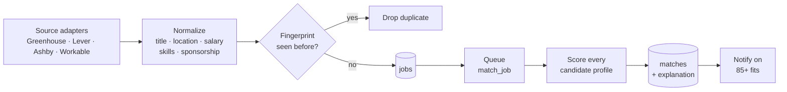

| Concern | How it is handled |
|---|---|
| Duplicates | A stable fingerprint of company, normalised title and country, so cross-posted roles collapse into one |
| Bad input | Malformed postings are rejected individually; one bad row never fails a run |
| Retries | Exponential backoff with jitter, then a dead-letter state after the max attempts |
| Idempotency | Every job carries a key, and enqueueing the same key twice creates one job |
| Concurrency | `FOR UPDATE SKIP LOCKED` lets many workers drain the queue without double-processing |
| Swapping sources | Each source implements one `JobSource` interface (Arbeitnow, Adzuna, The Muse, Greenhouse, Lever); adding a board is one adapter |

### Swappable AI

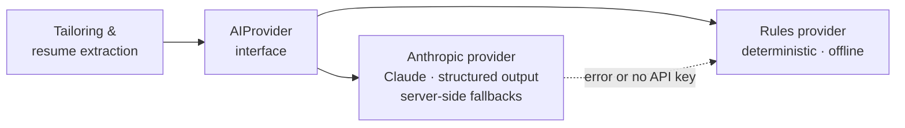

Product code never imports a model SDK directly. Claude output is validated against a Zod schema, and if the provider fails or no key is configured, the deterministic provider takes over so a candidate's workflow is never blocked.

### Application lifecycle

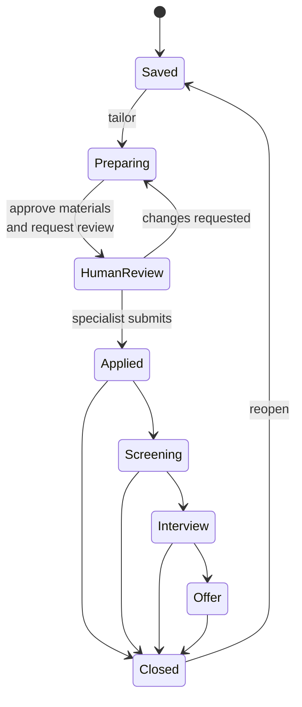

Candidates can move cards along allowed transitions. Entering human review requires an approved tailored document, and leaving it for *Applied* is something only a specialist can do.

### Data model

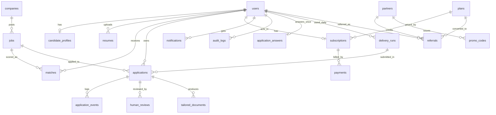

Plus `leads` for marketing enquiries, and `background_jobs`, `ingestion_runs`,
`idempotency_keys` and `rate_limits` for the pipeline. See
[`supabase/migrations`](supabase/migrations).

<br />

## Data sources & verification

Nothing in a profile or a job feed is invented. Every external source is a documented public API; nothing is scraped.

| What | Source | Key needed |
|---|---|---|
| **Skills** | Curated taxonomy (~330 skills with synonyms, keyed to Stack Overflow tags) → [Stack Exchange tags API](https://api.stackexchange.com/docs/tags) → [ESCO](https://esco.ec.europa.eu/en/use-esco/use-esco-services-api) → [Lightcast Open Skills](https://lightcast.io/open-skills) | No (Lightcast optional) |
| **Spelling help** | Edit-distance "did you mean" over the taxonomy and a bundled snapshot of the top 1,500 Stack Overflow tags (CC BY-SA 4.0) | No |
| **Roles** | ESCO occupation suggestions | No |
| **Locations** | [`country-state-city`](https://www.npmjs.com/package/country-state-city) (ISO 3166 + GeoNames cities) | No |
| **Email** | Syntax, disposable-domain list, and a DNS MX/A lookup on the domain | No |
| **GitHub** | [GitHub REST API](https://docs.github.com/rest): account exists, public languages and repositories | No (`GITHUB_TOKEN` raises limits) |
| **LinkedIn** | URL format only. LinkedIn has no public profile API, so links are shown to reviewers as **self-reported** | — |
| **Jobs** | [Arbeitnow](https://www.arbeitnow.com/blog/job-board-api) (on by default), [Adzuna](https://developer.adzuna.com), [The Muse](https://www.themuse.com/developers/api/v2), public Greenhouse / Lever boards | Arbeitnow: no. Others: yes |
| **Exchange rates** | European Central Bank daily reference rates via [Frankfurter](https://frankfurter.dev). Used only to *display* an indicative price; billing is always in the plan's currency | No |

**Trust levels are kept separate.** Every skill is *self-reported* until a reviewer approves the profile (*reviewer-approved*, recorded as a snapshot so later additions aren't presented as reviewed). Skills that also appear in the candidate's public GitHub repositories are labelled as *evidence*, never as verified credentials, and they don't add to match scores.

**Skills outside every vocabulary** can be sent for review from the skill search. Staff approve or reject them in **Operations → Skill requests**; approved skills join the shared vocabulary.

**Jobs pipeline:** fetch → HTML-to-text → location resolution against the city dataset → de-duplication by company + title + country → insert → batched matching. Listings a source stops showing (on a complete fetch) or older than `JOB_MAX_AGE_DAYS` are closed. If no source has refreshed successfully in 24 hours, candidates see a clear **"Live job data is unavailable"** notice. Locally bundled fictional listings are labelled **Sample** and are never written to a real database unless you run the demo seed.

**Human approval:** new and edited profiles enter a review queue with automatic flags (GitHub name mismatch, claimed years vs listed roles, skill years beyond total experience, missing resume…). Staff approve, reject or request changes with a note; the candidate is notified, every decision is audit-logged, and applications can only be sent for human review once the profile is approved.

<br />

## Security model

| Layer | What protects it |
|---|---|
| **Row Level Security** | Enabled on every table. Candidates see only their own rows; staff can read operational data. |
| **Column privileges** | A signed-in user cannot change their own `role` or `email`, only an allow-listed set of columns. |
| **System-authored rows** | Matches, AI events, audit logs and queue jobs are written server-side with the service role, never by a browser session. |
| **Storage** | Private bucket, objects namespaced `<user-id>/…`, short-lived signed URLs, and file type checked by **magic bytes** rather than the client's claim. |
| **Authorization** | Re-checked in a Data Access Layer on every page, action and route. The proxy is only an optimistic gate. |
| **Abuse** | Postgres-backed fixed-window rate limits, safe-redirect validation, and idempotency keys on mutating API calls. |
| **Observability** | Structured JSON logs with secret redaction, and an append-only audit trail of who did what. |
| **Secrets** | Service credentials never reach the client; production fails closed without a session secret. |
| **Input handling** | Every input is validated with Zod on the server (the browser runs the same rules for inline feedback). Queries go through the parameterised Supabase client; free-text search terms are stripped of filter syntax. Job HTML is reduced to plain text and only `http(s)` links are stored. |
| **Verification data** | `profile_verifications` and `skill_requests` have no write policies at all: only the server writes them, after checking the reviewer's role. |
| **EEO self-identification** | `SELECT` on `application_answers.self_identification` is revoked from `anon` and `authenticated`, and the readable columns are granted back by name. No browser session can read it — not even the row's owner's. The owner sees their own answers only because the server fetches them after authenticating the session; a specialist must name the form that needs them, and the unlock is audited. |
| **Service record** | `delivery_runs` has no write policy. A candidate can read what was done for them but can never claim work was done, so the count on their dashboard is only ever written by a specialist recording a real submission. |
| **Promo codes** | Live codes are world-readable so the pricing page can quote one before sign-in, but `EXECUTE` on `redeem_promo_code` is revoked from `public` as well as `anon`/`authenticated`, and the redemption cap is enforced inside the function — two concurrent checkouts cannot both take the last one. |
| **Leads** | Marketing enquiries are staff-read-only and have no browser write path; the public form posts through a server action that rate-limits by IP. |
| **Privacy** | Candidates can export everything held about them (`/api/me/export`) or delete their account from Settings; audit entries are kept without the IP address. |

These are not just claims: the test suite boots the real migrations in an in-process Postgres and asserts them (see [Testing](#testing)).

<br />

## Quick start

> No accounts, keys or database needed. The app runs on realistic seeded data out of the box.

```bash
git clone https://github.com/rohanmalyadri/SkyLark.git
cd SkyLark
npm install
npm run dev
```

Open <http://localhost:3000>, go to **Sign in**, and pick **Candidate** or **Operations** under *Explore with demo data*.

Demo mode keeps data in memory, so it resets whenever the server restarts.

<br />

## Run it for real (Supabase)

1. **Create a Supabase project.** Enable the Email provider, and Google if you want OAuth.
2. **Apply the migrations** in [`supabase/migrations`](supabase/migrations), in order (`supabase db push` or the SQL editor).
3. **Configure the environment.**
   ```bash
   cp .env.example .env.local
   ```
   Fill in `NEXT_PUBLIC_SUPABASE_URL`, `NEXT_PUBLIC_SUPABASE_ANON_KEY`, `SUPABASE_SERVICE_ROLE_KEY`, `CRON_SECRET`, and optionally `ANTHROPIC_API_KEY`.
4. **Load the demo dataset** (staging or demo projects only; it contains fictional sample listings):
   ```bash
   npm run seed -- --demo
   ```
5. **Deploy.** [`vercel.json`](vercel.json) schedules the background worker once a day (the Vercel Hobby plan allows daily crons only).

| Variable | Required | Purpose |
|---|:---:|---|
| `NEXT_PUBLIC_SUPABASE_URL` / `NEXT_PUBLIC_SUPABASE_ANON_KEY` | for production mode | Supabase project |
| `SUPABASE_SERVICE_ROLE_KEY` | for production mode | Server-only; system writes |
| `ANTHROPIC_API_KEY` | optional | Enables Claude; otherwise the rules provider is used |
| `AI_MODEL` | optional | Defaults to `claude-opus-5-5` |
| `CRON_SECRET` | production | Authorises `/api/cron/worker` |
| `SESSION_SECRET` | demo in production | Signs demo-mode sessions |
| `ADMIN_EMAILS` | optional | Comma-separated emails promoted to admin on sign-in |
| `SEED_DEMO_PASSWORD` | for `npm run seed` | Password for seeded accounts |
| `STACKEXCHANGE_KEY` | optional | Skill lookups: 10,000/day instead of 300/day per IP |
| `LIGHTCAST_CLIENT_ID` / `LIGHTCAST_CLIENT_SECRET` | optional | Adds Lightcast Open Skills to search and verification |
| `GITHUB_TOKEN` | optional | Scope-less token; GitHub checks at 5,000/hour instead of 60 |
| `EMAIL_DOMAIN_CHECK` | optional | `off` disables the sign-up DNS check (offline sandboxes) |
| `JOB_SOURCES` | optional | Allow-list of sources, e.g. `arbeitnow,adzuna` |
| `JOB_MAX_AGE_DAYS` | optional | Close listings older than this (default 45) |
| `ADZUNA_APP_ID` / `ADZUNA_APP_KEY` / `ADZUNA_COUNTRIES` | optional | Adzuna job search |
| `MUSE_API_KEY` | optional | The Muse job listings |
| `GREENHOUSE_BOARDS` / `LEVER_COMPANIES` | optional | Public company job boards to include |

<br />

## Testing

```bash
npm test          # unit tests + database / RLS tests
npm run test:e2e  # Playwright end-to-end (uses installed Edge; PW_CHANNEL=chrome to change)
npm run typecheck
npm run lint
```

- **Validation:** gibberish detection ("jhfavd"), names in any script, links, dates, education, duplicate skills.
- **Skills:** synonyms, spelling suggestions, live verification with mocked APIs, fail-closed when every vocabulary is down, review requests and staff-only decisions.
- **Jobs:** real-shaped Arbeitnow postings (escaped HTML, bare city names), de-duplication, expiry, failed fetches, the "live data unavailable" state.
- **Verification & privacy:** automatic flags, status transitions, permission checks, data export isolation, account erasure.
- **End to end:** invalid sign-up, duplicate accounts, missing onboarding fields, API failure handling, empty results, candidate access to admin pages, staff review flow, and phone-width layouts.

- **Answer vault:** an empty vault blocks rather than defaulting to "No", a `false` answer counts as answered, follow-up questions appear only once their trigger is "yes", voluntary self-identification never blocks a submission, and the owner can read their own EEO answers while a plain repository read cannot.
- **Managed delivery:** weekend days owe nothing, a candidate may lower but never raise their plan's quota, pausing drops the target to zero, runs are idempotent per day, only operators can claim or submit, submissions cannot be double-counted, and closing a short day requires a reason.
- **Money:** conversions return null rather than a guess when no rate is held, conversions are marked approximate and rounded, zero-decimal currencies never show cents, and an upstream failure leaves the billing currency alone instead of inventing a rate.
- **Content:** every post is checked for a unique slug, a publishable description length, real prose, no empty blocks and no raw HTML — the kind of breakage a typecheck cannot see.
- **Partners & promo codes:** percentage and fixed-amount discounts, never below zero, currency mismatch refused, plan restrictions, expiry and caps, quoting without consuming a redemption, one referral per account per partner, and barter partners earning no cash.
- **Matching engine:** sponsorship rules, blocked-eligibility capping, transferable skills, ranking.
- **Ingestion:** title cleaning, location and salary parsing, sponsorship detection, fingerprints.
- **Sessions:** tamper, expiry and fail-closed behaviour.
- **Database:** every migration is applied to an in-process Postgres ([PGlite](https://pglite.dev)), then the tests prove that candidates cannot read each other's rows, cannot promote themselves to admin, cannot forge AI-authored events, cannot write outside their storage folder, and that the queue claims each job exactly once. The managed-service tables are held to the same standard: **no session can read EEO self-identification** (the owner's included), candidates can read but never write a delivery run, the lead list is invisible to candidates and read-only for staff, live promo codes are public but unredeemable from the browser, and the redemption cap holds at exactly its limit.

> Two of those tests earned their keep immediately: they caught a column-level `REVOKE` that
> did nothing while a table-wide `SELECT` grant existed, and a `REVOKE EXECUTE` that left the
> default `PUBLIC` grant in place. Both were real holes in the first draft of the migration.

<br />

## API

| Endpoint | Description |
|---|---|
| `GET /api/v1/matches` | The signed-in candidate's ranked matches with per-factor explanations. Accepts the same filters as the UI. |
| `GET /api/v1/applications` | The candidate's tracker. |
| `POST /api/v1/applications` | Save a job. Requires an `Idempotency-Key` header; replays return the original response. |
| `GET /api/resumes/:id` | Owner download; staff can fetch a candidate's resume for verification (`?owner=`), which is audit-logged. |
| `GET /api/skills/suggest?q=` | Skill suggestions with spelling hints and degraded-source reporting. Rate limited. |
| `GET /api/roles/suggest?q=` | ESCO occupation suggestions. Rate limited. |
| `GET /api/geo/countries/:code/cities?region=` | Cities for a country and state. |
| `GET /api/me/export` | The signed-in person's data as JSON. |
| `GET /api/cron/worker` | Bearer-token protected; enqueues hourly ingestion and drains due jobs. |
| `GET /api/health` | Liveness probe. |

<br />

## Project structure

```
src/
├─ app/                    Routes
│  ├─ (marketing)/         Landing page, pricing, writing
│  ├─ (auth)/              Sign in, sign up
│  ├─ (app)/               Dashboard, jobs, applications, answers, profile, partner
│  ├─ admin/               Operations console (incl. delivery board, partners, leads)
│  ├─ r/[token]/           Partner share links
│  ├─ actions/             Server Actions (typed results, rate limited, audited)
│  └─ api/                 REST routes, cron worker, health
├─ components/
│  ├─ ui/                  Design system primitives
│  ├─ app/ · admin/        Product components
│  └─ marketing/           Landing page and hero demo
└─ lib/
   ├─ data/                Repository interface: Supabase + in-memory
   ├─ services/            Matching, tailoring, applications, reviews, billing, admin,
   │                        answers, delivery, partners, leads
   ├─ pipeline/            Sources, normalization, ingestion, queue, worker
   ├─ content/             Blog posts as typed content blocks
   ├─ ai/                  Provider interface: Claude + rules
   ├─ auth/ · infra/       Sessions, errors, rate limiting, logging, retries
   └─ seed/                Realistic fictional companies, jobs and people
supabase/
├─ migrations/             Schema, RLS and column grants, default plans
└─ tests/                  Database tests (real migrations, in-process Postgres)
```

<br />

## Design principles

- **Editorial and architectural.** Charcoal on white and off-white, square corners, hairline rules instead of floating cards. Display type is Inter Tight with tight tracking; numerals are set in Instrument Serif.
- **One signal colour, used sparingly.** Sky blue (`#2FA1D6`) appears only as flat shapes, figures and interactive emphasis.
- **Original artwork.** The monochrome clouds, contour lines, flight paths and profile study in `public/art/` are generated procedurally for SkyLark: no stock or third-party imagery.
- **Honest content.** Figures on the homepage come from the code (match factors, review checklist, review SLA, location data), domains come from the live job catalog, and the product illustration is labelled as sample data.
- **Motion communicates state.** Masked headline reveals, image curtains and stacking process panels built from CSS (scroll-driven where supported); nothing is hidden if JavaScript fails, and everything respects `prefers-reduced-motion`.
- **Every action has four states:** loading, success, failure and empty.
- **Accessible by default.** Visible focus, keyboard navigation, labelled controls, tables for chart data, and sensible contrast.
- **The human stays in charge.** AI proposes. You decide. A specialist verifies.

## License

SkyLark is released under the [MIT License](LICENSE). Copyright © 2026 Rohan Malyadri.

<br />

---

<div align="center">

### Made with ❤️ by **Team Synapse**

<sub>SkyLark is a capstone project, released under the MIT License. All companies, jobs and people shown are fictional.</sub>

</div>
