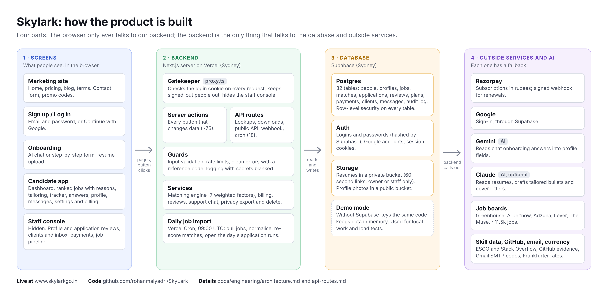
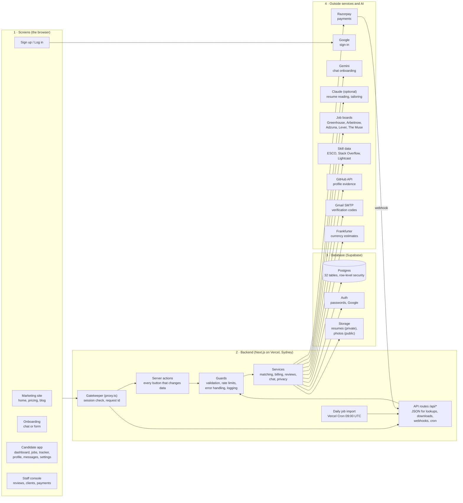

# How Skylark is built

One picture of the whole product, then a short plain-language note on every box. If you can point
at any box and say what it does and what breaks without it, you understand the product.

The same diagram as text (GitHub draws it as a chart):

## 1 · Screens

What people see in the browser. All of it is one Next.js app; the server builds each page and sends
finished HTML, so the browser never talks to the database directly.

| Box | What it is | Who uses it |
|---|---|---|
| **Marketing site** | Home page with the 3D hero, pricing, blog, how it works, terms, privacy. The contact form and the promo-code box are the only parts that send data. | Anyone |
| **Sign up / Log in** | Email and password, or "Continue with Google". | New and returning users |
| **Onboarding** | Builds the candidate's profile: a chat with an AI assistant, or a step-by-step form, plus a resume upload. | New candidates, once |
| **Candidate app** | Dashboard, ranked job matches with reasons, job detail and tailoring, application tracker board, answer vault, profile, messages with the team, settings and billing. | Signed-in candidates |
| **Staff console** | Hidden admin area (its address isn't linked anywhere and returns "not found" to anyone signed out). Profile reviews, application reviews, clients and inbox, payments, job pipeline, health. | Skylark staff only |

## 2 · Backend

The server half of the same Next.js app, hosted on Vercel in Sydney (next to the database, so each
query is a short trip).

| Box | Plain-language job | Where in the code |
|---|---|---|
| **Gatekeeper** | Runs before every page. Refreshes the login cookie, sends signed-out visitors to the login page, hides the staff console, and stamps each request with an id. It is only a first check; every action checks again. | `src/proxy.ts` |
| **Server actions** | The functions behind buttons and forms ("Save job", "Upload resume", "Pay"). The browser calls them like a function; Next.js turns that into a secure POST. Each one signs the user in, checks their role, applies a rate limit, validates the input and returns either a result or a clean error. | `src/app/actions/*` (wrapper in `_wrap.ts`) |
| **API routes** | Plain web addresses that return JSON or a file: location lists, skill suggestions, resume download, data export, the public candidate API (`/api/v1`), the Razorpay webhook and the cron entry point. Full list in [api-routes.md](api-routes.md). | `src/app/api/*`, `src/app/auth/*` |
| **Services** | The actual business rules: the matching engine and its 7 published weights, billing, reviews, the support chat, privacy export and delete. Actions and routes are thin; they call these. | `src/lib/services/*` |
| **Guards** | Shared safety code used by every action and route: input checks (Zod schemas plus gibberish, name, link and email-domain checks), rate limits, one error format with a reference code for unexpected failures, and a JSON logger that blanks out passwords, tokens and cookies. See [backend-hardening.md](backend-hardening.md). | `src/lib/validation`, `src/lib/domain/schemas.ts`, `src/lib/infra/*` |
| **Daily job import** | Once a day at 09:00 UTC, Vercel calls `/api/cron/worker` with a secret. It queues an import from every job board, normalises the listings, re-scores matches and opens the day's application runs. | `vercel.json`, `src/lib/pipeline/*` |

## 3 · Database (Supabase)

One hosted Supabase project in Sydney holds everything that must survive a restart.

| Box | Plain-language job |
|---|---|
| **Postgres** | 32 tables: users and profiles, jobs and companies, matches, applications and their events, reviews, plans, subscriptions and payments, clients and messages, audit log, rate-limit counters. **Row-level security**: when the app reads a candidate's own data it uses that person's login, and the database itself refuses to hand over anyone else's rows. Staff screens and background work use a separate privileged key that exists only on the server, and those code paths check roles and ownership themselves. Schema lives in `supabase/migrations`. |
| **Auth** | Stores passwords (hashed by Supabase, never by us) and Google logins, and issues the session cookie. |
| **Storage** | Files. Resumes go in a private bucket and are only handed out through a 60-second signed link after an ownership check. Profile photos go in a public bucket. |

Without Supabase keys the app runs in **demo mode**: the same code, but data lives in memory with
seeded sample people and jobs. That's what local development and the load test use.

## 4 · Outside services and AI models

Everything Skylark calls that it doesn't run itself. Each has a fallback, so one outage never takes
the product down.

| Service | What we use it for | If it fails |
|---|---|---|
| **Razorpay** | Monthly subscriptions in rupees. Checkout runs in Razorpay's window; a signed webhook tells us about renewals and failed charges. | Checkout is switched off; everything else works. |
| **Google** | "Continue with Google" sign-in (through Supabase). | Email and password still works. |
| **Gemini** (Google AI) | The chat version of onboarding: reads the candidate's answers and pulls out structured profile fields, which the server then validates like any form. | The step-by-step form is shown instead. |
| **Claude** (Anthropic, optional) | Reads uploaded resumes and drafts tailored bullet points and cover letters. Only used when a key is set. | A built-in rule-based reader takes over. |
| **Job boards** | Greenhouse company boards (Stripe, GitLab, Groww and others), Arbeitnow, plus Adzuna, Lever and The Muse when configured. About 11.5k live jobs. | The last imported jobs stay; the import retries next run. |
| **Skill data** | ESCO (EU job titles and skills), a Stack Overflow tag snapshot, optional Lightcast. Powers the "did you mean" skill and role suggestions. | The built-in curated skill list still works. |
| **GitHub API** | Shows a candidate's public repos to the reviewer as evidence. Never counted as a verified credential. | Reviewers just don't see the evidence panel. |
| **Gmail SMTP** | Sends 6-digit email verification codes. | Codes can't be sent; sign-up itself still works. |
| **Frankfurter** | Exchange rates so the pricing page can show rough prices in other currencies. Charges are always in rupees. | Prices show in rupees only. |

## A request, end to end

"Save this job" on the jobs page:

1. The browser calls `saveJobAction(jobId)`.
2. The gatekeeper refreshes the session cookie.
3. The action wrapper checks who is signed in, applies the 120-per-minute limit and validates
   `jobId`.
4. The applications service checks the job is still open, then writes a row in `applications`
   (tagged with this user's id), two timeline events in `application_events` and an audit-log line.
5. The browser gets `{ ok: true, message: "Saved to your shortlist" }` and shows a toast, or a clean
   error such as "You're doing that too often" if a guard said no.
