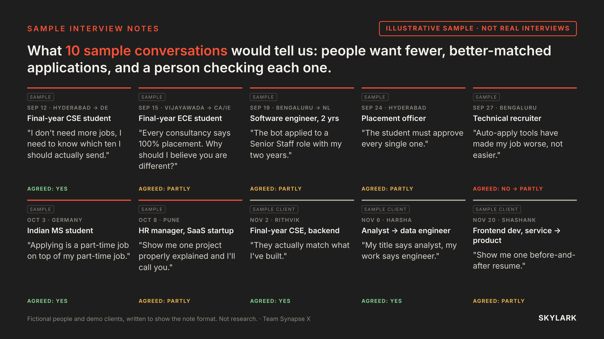

# Sample interview notes (illustrative, not real)

> [!WARNING]
> **Every note in this folder is an illustrative sample, not a real interview.**
> The interviewees are fictional, and the three client calls use the sample clients from Skylark's demo data.
> They exist to show what finished notes look like. They are not research, and they are not evidence for any
> claim about Skylark. Real interview notes go one folder up, in [`../`](../README.md).

The image is rendered from [`sample-summary.html`](sample-summary.html) by [`render.mjs`](render.mjs).

## Everyone in the samples

| # | Date | Role | How we met | One line they said | Agreed with our idea? | Notes |
|---|---|---|---|---|---|---|
| 1 | 2026-09-12 | Final-year CSE student, Hyderabad → Germany | In person | "I don't need more jobs, I need to know which ten I should actually send." | Yes | [Sample](2026-09-12-final-year-cse-student-germany.md) |
| 2 | 2026-09-15 | Final-year ECE student, Vijayawada → Canada/Ireland | Video call | "Every consultancy says 100% placement. Why should I believe you are different?" | Partly | [Sample](2026-09-15-final-year-ece-student-canada.md) |
| 3 | 2026-09-19 | Software engineer, 2 years, Bengaluru → Netherlands | Phone | "The bot applied to a Senior Staff role with my two years." | Partly | [Sample](2026-09-19-software-engineer-2y-netherlands.md) |
| 4 | 2026-09-24 | Training & placement officer, Hyderabad | In person | "The student must approve every single one." | Partly | [Sample](2026-09-24-placement-officer.md) |
| 5 | 2026-09-27 | Technical recruiter, staffing firm, Bengaluru | LinkedIn, call | "Auto-apply tools have made my job worse, not easier." | No → partly | [Sample](2026-09-27-tech-recruiter.md) |
| 6 | 2026-10-03 | Indian MS student in Germany | WhatsApp video | "Applying is a part-time job on top of my part-time job." | Yes | [Sample](2026-10-03-ms-student-germany.md) |
| 7 | 2026-10-08 | HR manager, SaaS startup, Pune | Zoom | "Show me one project properly explained and I'll call you." | Partly | [Sample](2026-10-08-hr-product-startup.md) |
| 8 | 2026-11-02 | Sample client Rithvik, final-year CSE, backend roles | Skylark Messages, call | "They actually match what I've built." | Yes | [Sample](2026-11-02-client-rithvik-final-year-backend.md) |
| 9 | 2026-11-06 | Sample client Harsha, data analyst → data engineer | Skylark Messages, video | "My title says analyst, my work says engineer." | Yes | [Sample](2026-11-06-client-harsha-analyst-to-data-engineer.md) |
| 10 | 2026-11-20 | Sample client Shashank, frontend dev, service → product | Skylark Messages, phone | "Show me one before-and-after resume." | Partly | [Sample](2026-11-20-client-shashank-service-to-product.md) |

## What the samples illustrate

- **Who:** 10 sample entries: 3 students, 1 working engineer, 1 placement officer, 1 recruiter, 1 HR manager, 3 sample clients.
- **Themes a real round might surface:** trust in paid "agents" is low; people want reasons for each match, not more matches;
  recruiters dislike mass-apply tools; candidates want to approve every application.
- **Disagreement:** the sample recruiter opposes automation outright, and the sample HR manager is not a buyer.
