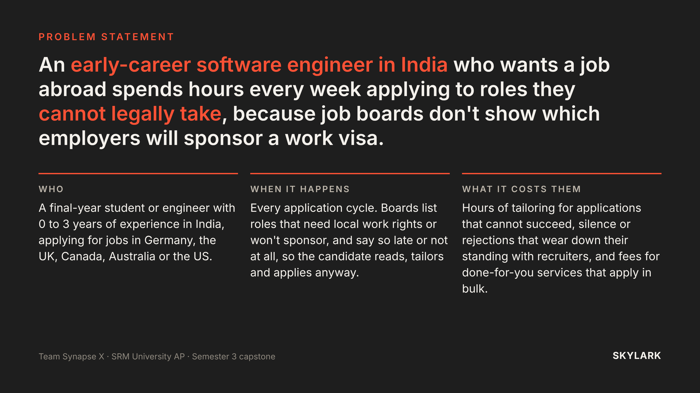

# Problem statement

## In one sentence

An early-career software engineer in India who wants a job abroad spends hours every week applying to
roles they cannot legally take, because job boards don't show which employers will sponsor a work visa.

## Who faces it

A final-year student, or an engineer with 0 to 3 years of experience, based in India and applying for
jobs in Germany, the UK, Canada, Australia or the US.

## When it comes up

Every time they look for work. Job boards list roles that need local work rights or won't sponsor a visa,
and often say so late in the description or not at all. The candidate reads the listing, tailors a resume,
fills in the employer's form and applies anyway.

## What it costs them

| Cost | Evidence | Source |
|---|---|---|
| Time spent on applications that cannot succeed | _To fill in from interviews: hours per week, applications per week_ | [Interview notes](../interview-notes/) |
| Standing with recruiters after repeated mass applications | _To fill in from interviews_ | [Interview notes](../interview-notes/) |
| Money paid to done-for-you application services | ApplyWizz, one such service, charges $140 to $260 a month after a first month of $209 to $400 | [ApplyWizz teardown](../research/competitive-teardown-applywizz.md), observed 2026-10-17 |

Only numbers with a named source go in this table. Fill the blank rows from the
[interview notes](../interview-notes/) and give the person's role and date when quoting them.

## What they do about it today

- Apply in bulk on general job boards and hope a few employers sponsor.
- Filter by hand: read each listing for visa or work-rights wording before applying.
- Pay a done-for-you service to apply on their behalf (see the teardown above).

_To confirm from interviews: which of these the people we met actually do._

## How Skylark answers it

See the [README](../../README.md#what-is-skylark). In short: eligibility and sponsorship are part of every
match score, so a role the candidate cannot take never outranks one they can.

---

The image is generated from [`problem-statement.html`](problem-statement.html). Edit the text there, then
run `node docs/problem-statement/render.mjs` to rebuild the PNG.
